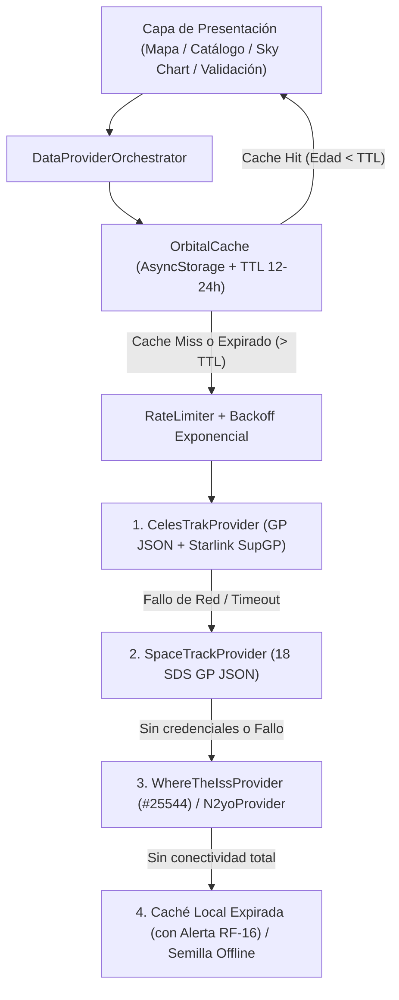

# Documento Técnico 3: Decisiones Arquitectónicas sobre Fuentes de Datos, Caso Starlink, Límites de Uso y Estrategia de Caché/Fallback

**Asignatura:** Programación Móvil — Licenciatura en Sistemas de Información (FCyT - UADER)  
**Trabajo Práctico N° 7:** Satellite Tracker — Capa de Acceso a Datos (`DataProvider`)

---

## 1. Caso de Estudio: Restricciones de las APIs de Starlink y Justificación de CelesTrak SupGP

Como caso de estudio de telecomunicaciones satelitales LEO, el Trabajo Práctico aborda el seguimiento de la megaconstelación **Starlink** (SpaceX). Tras relevar la documentación técnica oficial de SpaceX/Starlink, se fundamenta por qué no es posible consumir una API directa de Starlink desde una aplicación móvil pública y por qué la solución estándar en ingeniería aeroespacial es el **Set Suplementario de Elementos Generales (SupGP)** distribuido por **CelesTrak**:

### 1.1 Análisis de las APIs Oficiales de Starlink / SpaceX
1. **Starlink Enterprise APIs (Account, Telemetry & User Terminal Management):**
   * Están diseñadas exclusivamente para clientes corporativos o revendedores autorizados (*Authorized Resellers*) con cuentas Enterprise activas.
   * Exponen métricas de facturación, estado de terminales de usuario (*Dishy*), caudal de datos (*throughput*), latencia y diagnósticos de routers locales, pero **no exponen las efemérides ni las coordenadas orbitales de los satélites de la constelación**.
2. **SpaceX Space Traffic Coordination (STC) API:**
   * Es la plataforma mediante la cual SpaceX comparte efemérides de alta precisión y matrices de covarianza para evasión de colisiones (*Conjunction Assessment*).
   * Su acceso está **estrictamente restringido a operadores satelitales registrados y agencias gubernamentales de vigilancia espacial**, requiriendo acuerdos de intercambio de datos orbitales y **autenticación mutua TLS (mTLS) con certificados X.509 firmados por la Autoridad Certificadora de SpaceX**. Por diseño de seguridad operacional, es inaccesible para aplicaciones de usuario final.

### 1.2 Justificación del Uso de CelesTrak Supplemental GP (`SupGP`)
Para resolver la necesidad de seguimiento público y coordinación de radioastronomía/telecomunicaciones sin comprometer la seguridad de su API mTLS:
* SpaceX publica periódicamente vectores de estado y efemérides operacionales de alta precisión (que incluyen maniobras planificadas de ascenso y mantenimiento de estación con propulsores Hall).
* **CelesTrak** ingesta estas efemérides del operador, ajusta elementos medios SGP4 de alta fidelidad sobre ventanas cortas y los distribuye libremente a través del endpoint:
  ```
  https://celestrak.org/NORAD/elements/supplemental/sup-gp.php?FILE=starlink&FORMAT=json
  ```
* **Ventaja técnica frente a TLE convencionales:** Como los satélites Starlink maniobran continuamente con propulsión eléctrica, los TLE convencionales basados únicamente en observaciones radar pasivas de la red *Space Surveillance Network* (18 SDS) presentan errores mayores durante las fases de ascenso orbital. Los datos **SupGP** incorporan las efemérides reales provistas por SpaceX.

### 1.3 Adopción del Formato CCSDS OMM (JSON) frente a TLE
El formato TLE de 69 columnas diseñado en la década de 1960 asigna solo 5 dígitos al `NORAD_CAT_ID` (máximo `99999`). Dado el ritmo de lanzamientos de megaconstelaciones como Starlink, Kuiper y OneWeb, los objetos de 6 dígitos carecen de representación TLE numérica estándar. Por ello, [`CelesTrakProvider`](file:///c:/Users/alebo/OneDrive/Escritorio/Facu/lic%20y%20an%20en%20Sistemas/4to%20A%C3%B1o/Programaci%C3%B3n%20M%C3%B3vil/Trabajos%20Practicos/TP%207%20Satellite%20Tracker/src/providers/celestrakProvider.ts) y [`SpaceTrackProvider`](file:///c:/Users/alebo/OneDrive/Escritorio/Facu/lic%20y%20an%20en%20Sistemas/4to%20A%C3%B1o/Programaci%C3%B3n%20M%C3%B3vil/Trabajos%20Practicos/TP%207%20Satellite%20Tracker/src/providers/spaceTrackProvider.ts) consumen nativamente **JSON OMM (CCSDS Orbit Mean-Elements Message v3.0)** y los compilan con `json2satrec()` de `satellite.js` v7.1.0.

---

## 2. Límites de Uso de cada Proveedor y Diseño del Rate Limiter

Las APIs nunca se consultan en cada frame de la interfaz (la propagación SGP4 a 1–5 s ocurre 100% localmente en el dispositivo). Aun así, para proteger las cuotas de cada proveedor ante búsquedas o validaciones repetidas, [`rateLimiter.ts`](file:///c:/Users/alebo/OneDrive/Escritorio/Facu/lic%20y%20an%20en%20Sistemas/4to%20A%C3%B1o/Programaci%C3%B3n%20M%C3%B3vil/Trabajos%20Practicos/TP%207%20Satellite%20Tracker/src/providers/rateLimiter.ts) aplica ventanas deslizantes por minuto y por hora, espaciamiento mínimo entre peticiones (`minIntervalMs`) y **cola de reintentos con backoff exponencial y jitter aleatorio** ($t_{\text{backoff}} = 1200 \cdot 2^{\text{intento}} + U(0, 300)\text{ ms}$):

| Proveedor (`DataProviderId`) | Rol en la Arquitectura | Autenticación | Límite Oficial del Proveedor | Configuración en `RateLimiterManager` |
| :--- | :--- | :--- | :--- | :--- |
| **CelesTrak** (`celestrak`) | Proveedor primario de catálogos GP (OMM JSON) y Starlink `SupGP` | Pública (Sin API Key) | Actualiza cada 24 h; bloquea IPs con consultas repetitivas | Máx **12 req/min**, **100 req/h**, intervalo mín. `800 ms` |
| **Space-Track.org** (`spacetrack`) | Catálogo oficial 18 SDS; primer fallback de datos orbitales | Cuenta (`identity` / `password` en `SecureStore`) | **$< 30\text{ req/min}$** y **$< 300\text{ req/hora}$** | Máx **25 req/min**, **250 req/h**, intervalo mín. `1200 ms` |
| **N2YO** (`n2yo`) | Validación cruzada de posiciones/az/el para cualquier satélite y fallback TLE | `apiKey` gratuita en `SecureStore` | **$1.000\text{ transacciones/h}$** (TLE/posiciones); $100\text{/h}$ (pases) | Máx **30 req/min**, **800 req/h**, intervalo mín. `500 ms` |
| **Where the ISS at?** (`wheretheiss`) | Validación en tiempo real sin credenciales y fallback TLE para la ISS (`#25544`) | Pública (Sin autenticación) | **$\approx 1\text{ request/segundo}$** (Solo NORAD `25544`) | Máx **45 req/min**, **1200 req/h**, intervalo mín. `1050 ms` |

---

## 3. Arquitectura de Abstracción, Caché Local con TTL y Conmutación (Fallback)



### 3.1 Estrategia de Caché Local y Operación Offline
* [`orbitalCache.ts`](file:///c:/Users/alebo/OneDrive/Escritorio/Facu/lic%20y%20an%20en%20Sistemas/4to%20A%C3%B1o/Programaci%C3%B3n%20M%C3%B3vil/Trabajos%20Practicos/TP%207%20Satellite%20Tracker/src/providers/orbitalCache.ts) almacena en `AsyncStorage` cada catálogo y satélite individual junto con su marca temporal `fetchedAtMs`, el `providerId` de origen y el `ttlHours` configurable entre **12 h y 24 h** (por defecto **12 h**).
* Si el usuario abre la aplicación en el campo (por ejemplo, apuntando una antena en una zona rural sin cobertura celular durante el momento del pase), el orquestador entrega inmediatamente los elementos orbitales almacenados en caché local y calcula la posición, el azimut/elevación y el Sky Chart de forma 100% autónoma.
* Si la antigüedad de la época del elemento orbital supera las 24 horas (**RF-16**), la interfaz muestra un banner ámbar de advertencia indicando las horas de antigüedad y ofreciendo actualizar cuando recupere conectividad.

### 3.2 Gestión Segura de Credenciales
Siguiendo la recomendación de seguridad de la Sección 4.3, el código fuente y el bundle de la aplicación **no contienen ninguna credencial hardcodeada**. [`credentialStore.ts`](file:///c:/Users/alebo/OneDrive/Escritorio/Facu/lic%20y%20an%20en%20Sistemas/4to%20A%C3%B1o/Programaci%C3%B3n%20M%C3%B3vil/Trabajos%20Practicos/TP%207%20Satellite%20Tracker/src/providers/credentialStore.ts) utiliza `expo-secure-store` (Keychain cifrado en iOS y EncryptedSharedPreferences/Keystore en Android) para almacenar de forma segura la API Key de N2YO y las credenciales de Space-Track ingresadas por el usuario desde la pestaña **Validación**.

